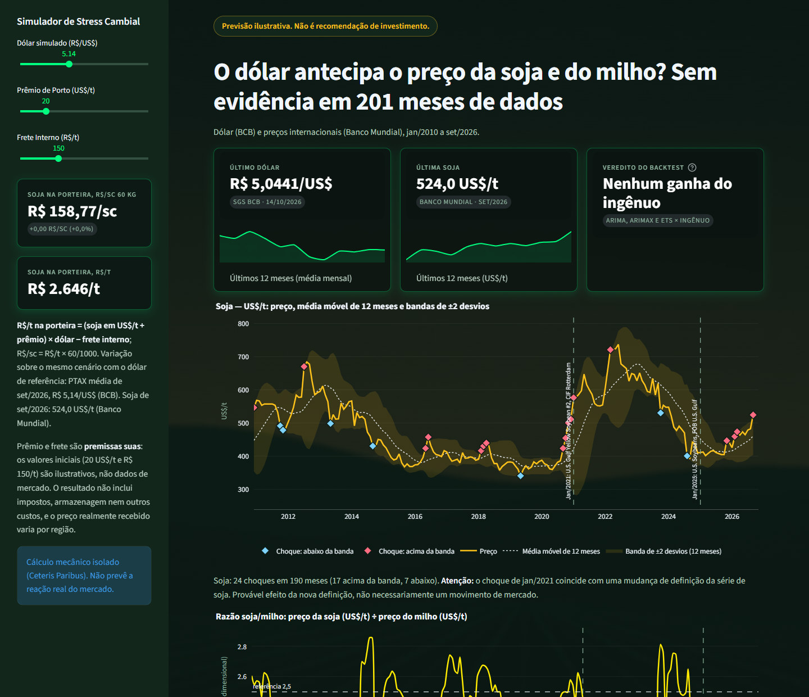

# Monitor de Commodities

**Em 3 linhas**
1. Acompanha o dólar e os preços internacionais de soja, milho e trigo, só com dados públicos do Banco Central e do Banco Mundial.
2. Pergunta central: o dólar de hoje ajuda a prever o preço dessas commodities nos meses seguintes? Em 201 meses de dados, não: os testes estatísticos não acharam essa relação e nenhum modelo de previsão (ARIMA, ARIMAX, ETS) errou menos do que simplesmente repetir o último preço.
3. Mostra também risco, a razão soja/milho e um simulador do preço da soja "na porteira" (dólar, prêmio de porto e frete que você escolhe). A previsão é ilustrativa.

> **Não é recomendação de investimento.** A previsão é ilustrativa.



**App publicado:** <https://monitor-commodities.streamlit.app>
Para rodar localmente, veja a seção "Dashboard".

**O que o dashboard traz**
- **Trigo** (`Wheat, US HRW`, Banco Mundial) ao lado de soja e milho em preços, conversões para R$ e R$/sc, correlação, risco e
  bandas de Bollinger. A defasagem (Granger) e o backtest seguem só com soja e milho (seção "Trigo").
- **ARIMAX** (dólar defasado em 1 mês como variável explicativa) no backtest, comparado ao ingênuo: **não ganha**. Em 27 testes
  (3 modelos × 3 horizontes × 3 casos), nenhum modelo erra significativamente menos que repetir o último valor, e o ARIMAX na soja desde 2021
  com horizonte de 1 mês erra cerca de 40% mais (rMAE 1,40; p ajustado 0,034). Detalhes em "Previsão e backtest".
- **Simulador de soja na porteira** (painel lateral): R$/t = (soja US$/t + prêmio de porto) × dólar − frete interno, e R$/sc de 60 kg.
  Prêmio e frete são premissas suas, não dados de mercado (seção "Razão soja/milho e simulador de câmbio").

## Fontes de dados

| Série | Fonte | Licença / termos |
|---|---|---|
| Dólar — PTAX de fechamento, venda (R$/US$), diário | Banco Central do Brasil — SGS, série 1: *Taxa de câmbio - Livre - Dólar americano (venda) - diário* | Dados públicos, com citação da fonte |
| Soja, milho e trigo — preços internacionais mensais (US$/t), dashboard público | Banco Mundial — *Commodity Price Data (The Pink Sheet)* | [CC BY 4.0](https://datacatalog.worldbank.org/search/dataset/0038238/commodity-prices-history-and-projections) |
| Soja — Indicador CEPEA/ESALQ Paranaguá e Paraná (apenas local) | CEPEA/ESALQ-USP | [CC BY-NC 4.0](https://www.cepea.org.br/br/licenca-de-uso-de-dados.aspx) — ver nota abaixo |
| Milho — Indicador ESALQ/B3 Campinas (apenas local) | CEPEA/ESALQ-USP | [CC BY-NC 4.0](https://www.cepea.org.br/br/licenca-de-uso-de-dados.aspx) — ver nota abaixo |
| Preços por UF e safra (contexto) | CONAB — Preços de Mercado / Portal de Informações | Licença dos dados **não declarada** (em consulta ao SIC da CONAB); páginas gov.br sob CC BY-ND 3.0 |

**Licenças:** o código deste repositório é [MIT](LICENSE); os dados seguem as licenças de cada fonte, listadas na tabela acima.

### Banco Mundial (Pink Sheet)

> Fonte: World Bank, *Commodity Price Data (The Pink Sheet)*, CC BY 4.0. Dados reformatados
> (mensal, US$/t), com conversão para R$ pela PTAX do BCB.

- Arquivo oficial: `CMO-Historical-Data-Monthly.xlsx`, aba "Monthly Prices", séries
  `Soybeans`, `Maize` e `Wheat, US HRW`, em US$ nominais por tonelada métrica. Disponível em
  <https://www.worldbank.org/en/research/commodity-markets>; licença no registro do
  [Data Catalog (dataset 0038238)](https://datacatalog.worldbank.org/search/dataset/0038238/commodity-prices-history-and-projections)
  e nos [termos de uso para datasets](https://www.worldbank.org/ext/en/legal/terms-conditions/datasets).
- "Dados reformatados" significa: período `AAAAMmm` convertido para data (1º dia do mês) e
  colunas padronizadas. Os valores em US$/t não são alterados; a conversão para R$ é feita na
  análise, não nos arquivos de `data/processed/`.
- **Fontes de terceiros:** a aba "Description" do arquivo cita como fontes primárias dos
  preços S&P Global (antiga IHS Markit), Bloomberg Finance L.P., ISTA Mielke GmbH (Oil World)
  e o Departamento de Agricultura dos EUA (USDA). O Banco Mundial publica o conjunto sob
  CC BY 4.0 e os metadados do dataset não indicam restrições adicionais de terceiros.
- O arquivo é atualizado no 2º dia útil de cada mês e baixado **manualmente** para
  `data/raw/worldbank/` (o link muda a cada edição).
- São preços **internacionais** (portos dos EUA/Europa), não preços pagos no Brasil: a
  conversão para R$ não inclui prêmio de porto nem frete interno.

#### Mudança de definição da série de soja

A série `Soybeans` mudou de definição ao longo do tempo (aba "Description"):

| Período | Definição |
|---|---|
| até nov/2007 | origem EUA, *nearest forward* |
| dez/2007 – dez/2020 | U.S. No. 2 yellow, CIF Rotterdam |
| jan/2021 – dez/2024 | U.S. Gulf Yellow Soybean #2, CIF Rotterdam |
| desde jan/2025 | U.S. Soybeans, FOB U.S. Gulf |

CIF Rotterdam inclui frete e seguro até a Europa; FOB Golfo não. Por isso a passagem de
jan/2025 pode criar um degrau que não é variação de mercado. Os gráficos de soja marcam
**jan/2021** e **jan/2025**, e a previsão refaz o backtest da soja só com dados desde jan/2021 como teste de robustez (sem variável
indicadora: ARIMA e ETS são univariados e o ARIMAX usa só o dólar defasado como exógena). A série `Maize` (U.S. No. 2
yellow, FOB US Gulf) não tem mudança de definição registrada.

### Dados do CEPEA não são redistribuídos aqui

A licença de dados do CEPEA (CC BY-NC 4.0) permite uso não comercial com crédito, mas a
[Política de Direitos Autorais](https://www.cepea.org.br/br/politica-de-direitos-autorais-1.aspx)
exige autorização formal para retransmitir conteúdo e diz que "não é permitida [...] a
transmissão de séries de preços". Por isso, até haver autorização por escrito do CEPEA:

- as planilhas são baixadas **manualmente** no site do CEPEA (formulário de download) e salvas
  em `data/raw/cepea/`; o código não acessa o site do CEPEA;
- os arquivos `data/processed/cepea_*.parquet` ficam **fora do repositório** (`.gitignore`);
- o dashboard público não exibe as séries do CEPEA; elas aparecem apenas ao rodar localmente.

Os demais arquivos de `data/processed/` são derivados das fontes públicas acima e
redistribuídos nos termos de cada uma.

## Período

Desde 2010 ou o máximo disponível em cada fonte. As análises que cruzam séries usam apenas o
período em comum entre elas: **2010-01 a 2026-09 (201 meses)** com a edição do Pink Sheet de 02/10/2026
(detalhes na seção "Análise").

## Análise

```powershell
python -m monitor.analise
```

- **Período em comum:** 2010-01 a 2026-09 (201 meses). O dólar começa em jan/2010; o Pink
  Sheet termina no último mês publicado. Meses fora desse período (inclusive o mês corrente,
  cuja média da PTAX ainda é parcial) ficam fora de todas as contas.
- **Dólar mensal:** média simples da PTAX venda diária de cada mês (R$/US$) — mesma base do
  Pink Sheet, que publica médias mensais.
- **Conversão:** R$/t = US$/t × PTAX média do mês; por saca de 60 kg = valor por tonelada ×
  60/1000. Cada resultado traz a unidade (`US$/t`, `R$/t`, `US$/sc 60 kg`, `R$/sc 60 kg`,
  `R$/US$`, `% m/m (...)`, `log-retorno mensal (...)`).
- **Variação mensal:** variação % sobre o mês anterior; exige meses consecutivos.
- **Correlação de retornos:** Pearson sobre retornos log mensais (não sobre níveis, que dão
  correlação espúria por causa da tendência), com IC de 95% e p-valor.

Resultado com a edição do Pink Sheet de 02/10/2026 (n = 200 retornos, 2010-02 a 2026-09):

| Retorno log mensal do dólar (R$/US$) × | r | IC 95% |
|---|---|---|
| Soja em **US$/t** | −0,262 | −0,387 a −0,128 |
| Soja em **R$/t** | +0,423 | +0,302 a +0,531 |
| Milho em **US$/t** | −0,212 | −0,341 a −0,076 |
| Milho em **R$/t** | +0,346 | +0,218 a +0,463 |
| Trigo em **US$/t** | −0,181 | −0,312 a −0,044 |
| Trigo em **R$/t** | +0,338 | +0,209 a +0,455 |

Como ler:
- **Em R$/t a correlação positiva é em boa parte mecânica**: o preço em R$ é o preço em US$
  multiplicado pelo câmbio, então o retorno em R$ ≈ retorno em US$ + retorno do dólar. Mesmo
  com dólar e preço internacional independentes, a correlação sairia positiva (há um teste
  com dados sintéticos que mostra isso).
- **Em US$/t a correlação é negativa e modesta**: nos meses em que o dólar sobe frente ao real,
  os preços internacionais de soja, milho e trigo em dólar tendem a cair um pouco. É uma associação
  no mesmo mês, não causalidade; se o dólar *antecipa* os preços é a pergunta da análise de
  defasagem (abaixo).

## Análise de defasagem

```powershell
python -m monitor.analise.defasagem
```

Pergunta: o dólar de meses anteriores ajuda a explicar o preço de soja e milho hoje? Tudo em
**retornos log mensais**: dólar (R$/US$) contra soja e milho em **US$/t** (em R$/t haveria o
efeito mecânico da conversão). Defasagem k = dólar no mês t−k contra o preço no mês t.

- **Estacionariedade (ADF, com constante, defasagens por AIC):** os três retornos rejeitam a
  raiz unitária com folga — dólar −9,57; soja −12,65; milho −9,05 (estatística ADF,
  adimensional; valor crítico de 5%: −2,88; p < 10⁻¹⁴). Os testes abaixo são válidos sobre eles.
- **Correlação cruzada:** Pearson (r, adimensional) para k = 0 a 12 meses.
- **Granger (exploratório):** teste F "o dólar antecipa o preço" com p = 1 a 12 defasagens de
  cada série. Granger mede ganho de previsão, não causa econômica.
- **Soja com e sem as quebras de definição:** a variante "sem quebras" exclui os retornos de
  jan/2021 e jan/2025 (que comparam duas definições da série) e toda linha que os usa como
  defasagem.
- **Múltiplos testes:** são 75 testes (3 casos × 13 correlações + 12 Granger). Os p-valores são
  ajustados por **Benjamini-Hochberg** sobre todos juntos (taxa de falsas descobertas de 5%).
  Os testes são correlacionados entre si (defasagens vizinhas, soja com e sem quebras); o BH é
  válido sob dependência positiva, mas isso continua sendo exploração, não confirmação. Sem
  ajuste, 75 testes a 5% dariam cerca de 3 a 4 falsos positivos só por acaso (75 × 0,05 ≈ 3,75).

Resultado (edição do Pink Sheet de 02/10/2026; retornos de 2010-02 a 2026-09):

| Retorno do dólar × | k = 0: r (p BH) | Menor p bruto com k ≥ 1 | Granger, menor p BH |
|---|---|---|---|
| Soja US$/t, série completa | −0,262 (0,007) | k = 4: r = +0,188, p = 0,008 (BH 0,13) | 0,57 |
| Soja US$/t, sem quebras | −0,281 (0,005) | k = 4: r = +0,198, p = 0,006 (BH 0,11) | 0,57 |
| Milho US$/t | −0,212 (0,064) | k = 9: r = +0,157, p = 0,030 (BH 0,37) | 0,69 |

Como ler:
- **Não há evidência de que o dólar antecipe soja ou milho em US$/t.** Nenhuma defasagem de 1 a
  12 meses e nenhum teste de Granger fica significativo depois do ajuste BH.
- A soja na defasagem 4 e o milho na 9 teriam p < 0,05 isolados — é o tipo de achado que surge
  por acaso quando se testa muita coisa, e por isso não é tratado como resultado.
- Só a relação **no mesmo mês** (k = 0, já vista na correlação) sobrevive para a soja. Ela é
  **simultânea, não preditiva**: o dólar de um mês não ajuda a prever o preço do mês seguinte.
- Para o milho, a relação no mesmo mês é **inconclusiva** (p ajustado = 0,064, acima de 5%).
- Tirar as quebras de jan/2021 e jan/2025 quase não muda a soja: a conclusão não depende delas.
- Consequência para a previsão: o dólar defasado não entra como variável explicativa por padrão; o ARIMAX o testa à parte.

## Previsão e backtest

```powershell
python -m monitor.previsao
```

Leva cerca de 6 minutos (um ajuste por origem, modelo e ordem candidata; o ARIMAX é o mais lento).

**Modelos** (sobre o log do preço em US$/t; ARIMA e ETS são univariados e o ARIMAX usa o dólar defasado como
exógena; a previsão volta ao nível com exp, o que dá a mediana prevista):
- **Ingênuo** (referência): repete o último valor. Intervalo de passeio aleatório (σ das
  variações da janela × √h).
- **ARIMA(p,1,q)** sem constante, com p, q ≤ 2. A ordem é escolhida **dentro de cada janela**
  por AICc. ARIMA(0,1,0) é o próprio ingênuo e está entre as opções.
- **ETS** de erro aditivo, sem sazonalidade: nível simples (A,N,N) ou tendência amortecida
  (A,Ad,N), escolhido por AICc dentro de cada janela.
- **ARIMAX(p,1,q)** (como o ARIMA, com o dólar como exógena): o log do dólar (média mensal da PTAX, R$/US$) **defasado em 1
  mês**, de modo que o retorno do preço do mês t seja explicado pelo retorno do dólar de t−1. Para o horizonte h não há previsão
  do dólar: o 1º mês à frente usa o dólar da própria origem (já conhecido) e os demais repetem esse valor (dólar ingênuo). Nada
  posterior à origem entra (um teste muda o dólar a partir de um mês e confere que as previsões anteriores não mudam). Quando
  falta o dólar defasado em algum mês da janela (a série do dólar começa em jan/2010), o ARIMAX pula aquela origem: a 1ª origem
  de cada caso fica sem ARIMAX e a rMAE usa só as origens em comum com o ingênuo.

**Backtest:**
- Janela deslizante de **60 meses**. Em cada origem, o modelo vê só os 60 meses que terminam
  nela e prevê **1, 3 e 6 meses** à frente.
- Nada do futuro entra no treino: um teste muda todos os preços a partir de um mês e confere
  que as previsões feitas antes dele não mudam.
- Erro = real − previsto, em US$/t.
- **Razão de MAE (rMAE) vs ingênuo** = MAE do modelo ÷ MAE do ingênuo, nas mesmas origens e
  no mesmo horizonte, fora da amostra. Abaixo de 1, o modelo erra menos que o ingênuo. Não é o
  MASE de Hyndman, que divide pelo erro do ingênuo **dentro** da amostra de treino.
- IC de 95% da rMAE por **bootstrap circular em blocos** (2.000 reamostragens), reamostrando
  as origens em pares (modelo e ingênuo juntos). O bloco tem max(h, ⌈T^(1/3)⌉) origens.
- **Diebold-Mariano com a correção de Harvey, Leybourne e Newbold (1997)**, com a mesma perda
  da rMAE (erro absoluto):
  - em previsões de h meses feitas a partir de origens consecutivas, as janelas de previsão se
    **sobrepõem** (as previsões de 6 meses feitas em janeiro e em fevereiro compartilham 5
    meses). Por isso os erros ficam autocorrelacionados até a defasagem h−1;
  - a variância de longo prazo soma as autocovariâncias até h−1 com pesos iguais, como em DM
    e HLN. Se esse estimador der negativo, o que pode acontecer em amostras pequenas, usa os
    pesos de Bartlett (Newey-West);
  - a estatística é multiplicada por √[(T + 1 − 2h + h(h−1)/T) / T] e comparada com a t de
    Student com T−1 graus de liberdade. Isso corrige a tendência do DM original de rejeitar
    demais em amostras pequenas. Um teste com 600 simulações MA(5) mostra que a taxa de
    rejeição a 5% fica perto da nominal;
  - os p-valores dos 27 testes (3 modelos × 3 horizontes × 3 casos) são ajustados por
    Benjamini-Hochberg.
- **Veredito:** "ganha" ou "perde" do ingênuo só se o DM for significativo depois do BH;
  fora isso, "sem diferença significativa". Os ICs da rMAE são individuais, sem ajuste para
  múltiplos testes.
- **Robustez da soja:** o backtest é refeito só com dados **desde jan/2021**, por causa da
  quebra de definição. Com a janela de 60 meses sobrariam só 9 origens, então essa variante
  usa uma **janela de 36 meses**. Ela ainda inclui a quebra de jan/2025 (CIF Rotterdam → FOB
  Golfo) e tem poucas origens (28 a 33), então é uma **checagem de sensibilidade**, não um
  teste conclusivo.

Resultado (edição do Pink Sheet de 02/10/2026; rMAE vs ingênuo com IC 95%, p do DM-HLN bruto e ajustado):

| Caso | Modelo | h = 1 | h = 3 | h = 6 |
|---|---|---|---|---|
| Soja, 2010–2026 (T = 141/139/136) | ARIMA | 1,04 [0,99; 1,09] p 0,21 (BH 0,51) | 1,04 [0,98; 1,11] p 0,25 (BH 0,52) | 1,03 [0,98; 1,10] p 0,29 (BH 0,52) |
|  | ARIMAX | 1,04 [0,99; 1,10] p 0,20 (BH 0,51) | 1,05 [0,98; 1,12] p 0,17 (BH 0,50) | 1,04 [0,97; 1,11] p 0,32 (BH 0,52) |
|  | ETS | 1,06 [1,02; 1,11] p 0,10 (BH 0,44) | 1,09 [1,02; 1,17] p 0,06 (BH 0,33) | 1,08 [0,96; 1,25] p 0,38 (BH 0,56) |
| Soja, desde 2021 (T = 33/31/28) | ARIMA | 1,22 [1,08; 1,38] p 0,007 (BH 0,09) | 1,20 [1,08; 1,36] p 0,03 (BH 0,17) | 1,02 [0,86; 1,23] p 0,79 (BH 0,80) |
|  | ARIMAX | 1,40 [1,16; 1,78] p 0,001 (BH 0,034) | 1,23 [1,07; 1,46] p 0,01 (BH 0,13) | 1,15 [0,99; 1,53] p 0,16 (BH 0,50) |
|  | ETS | 1,02 [0,91; 1,18] p 0,70 (BH 0,77) | 1,02 [0,90; 1,21] p 0,80 (BH 0,80) | 1,09 [1,00; 1,34] p 0,12 (BH 0,45) |
| Milho, 2010–2026 (T = 141/139/136) | ARIMA | 0,98 [0,90; 1,07] p 0,61 (BH 0,72) | 1,01 [0,95; 1,08] p 0,71 (BH 0,77) | 1,01 [0,95; 1,07] p 0,61 (BH 0,72) |
|  | ARIMAX | 1,04 [0,94; 1,15] p 0,47 (BH 0,67) | 1,02 [0,97; 1,07] p 0,50 (BH 0,67) | 1,01 [0,96; 1,06] p 0,55 (BH 0,71) |
|  | ETS | 1,01 [1,00; 1,04] p 0,27 (BH 0,52) | 1,02 [1,00; 1,05] p 0,31 (BH 0,52) | 1,02 [1,00; 1,07] p 0,27 (BH 0,52) |

**Os modelos não ganham do ingênuo.** Em nenhum dos 27 casos o ARIMA, o ARIMAX ou o ETS erra
significativamente menos que repetir o último valor. Na maioria, a rMAE fica um pouco acima
de 1. A única rMAE abaixo de 1 (ARIMA no milho com h = 1, 0,98) tem IC que inclui 1 e p = 0,61.
- **O dólar defasado não ajuda a prever (ARIMAX).** Na série completa, o ARIMAX fica em 1,04–1,05 na soja e 1,01–1,04 no milho,
  sem diferença significativa; a ordem mais escolhida é (0,1,0) na soja (cerca de 51% das origens) e (0,1,1) no milho (cerca de 54%). Isso
  confirma, agora em previsão fora da amostra, o resultado da defasagem (Granger sem significância).
- **Um caso significativo, contra o modelo:** na soja desde 2021 com h = 1, o ARIMAX erra cerca de 40% mais que o ingênuo
  (rMAE 1,40; p bruto 0,001; BH 0,034). É o único dos 27 testes que passa pelo ajuste, e a favor do ingênuo. É uma checagem de
  sensibilidade (33 origens, janela de 36 meses, inclui a quebra de definição da soja), então não se deve generalizar.
- Adicionar o ARIMAX aumentou de 18 para 27 os testes e, com isso, mudou os p-valores ajustados (BH) dos outros modelos (os p brutos
  não mudam). O ARIMA da soja desde 2021 com h = 1, por exemplo, passou de BH 0,12 para 0,088, ainda sem significância.
- Alguns ICs da rMAE ficam inteiros acima de 1 (por exemplo, o ETS na soja). Nesses casos o
  modelo provavelmente erra **mais** que o ingênuo, mas o DM-HLN com BH não confirma.
- Na soja desde 2021, o ARIMA erra cerca de 20% a mais que o ingênuo em 1 e 3 meses
  (p bruto 0,007 e 0,03), mas o resultado não sobrevive ao BH. Nessa checagem de
  sensibilidade, a conclusão da série completa (nenhum ganho sobre o ingênuo) se mantém.
- Nas janelas, a ordem mais escolhida para a soja é ARIMA(0,1,0), que é o próprio ingênuo
  (55% das origens). O ETS escolhe (A,N,N) em 76–77% das origens na soja (conforme o horizonte) e em 95% no milho, com suavização alta,
  que fica perto do ingênuo. Isso é compatível com preços mensais que se comportam como passeio aleatório.
- **Cobertura dos intervalos de 95%** (série completa, nas origens do backtest): 89% a 94% para o intervalo do
  ingênuo, que é o exibido no dashboard, e 87% a 94% para os intervalos de ARIMA, ARIMAX e ETS. Todos ficam um pouco
  abaixo do nominal: os intervalos subestimam a incerteza (choques de preço maiores que os da janela de treino).

**Previsão ilustrativa** (últimos 60 meses até set/2026, intervalo de 95%, US$/t): os modelos
ficam praticamente iguais ao último valor.

| | Último (set/2026) | out/2026 | dez/2026 | mar/2027 |
|---|---|---|---|---|
| Soja, ingênuo | 524,0 | 524,0 [472,0; 581,7] | 524,0 [437,2; 628,0] | 524,0 [405,6; 676,9] |
| Milho, ingênuo | 239,6 | 239,6 [213,9; 268,4] | 239,6 [196,9; 291,6] | 239,6 [181,5; 316,3] |

Como nenhum modelo ganhou do ingênuo, a previsão a mostrar no dashboard é a **ingênua com
intervalo**: o valor central é o último preço e o intervalo dá a faixa de incerteza. A
previsão está em US$/t; convertê-la para R$ exigiria também prever o dólar.

> **Não é recomendação de investimento.** A previsão é ilustrativa.

## Dashboard

```powershell
python -m monitor.resultados          # ~6 min: refaz backtest e análises e grava data/processed/resultados_*
streamlit run app/streamlit_app.py
```

O app só **lê** arquivos (`ptax_venda`, `wb_soja`, `wb_milho`, `wb_trigo` e `resultados_*.parquet`/`resultados_meta.json`);
não recalcula modelos nem baixa dados. As únicas contas são a conversão de US$/t para R$ ao carregar e o simulador de câmbio. Os `resultados_*` derivam só de BCB e Banco Mundial (a coluna `fonte`
registra isso e `monitor.resultados.validar_fontes` recusa qualquer menção a CEPEA/CONAB), por isso entram no git.
De cima para baixo: aviso de previsão ilustrativa, título com a conclusão, três cartões lado a lado (último dólar e
última soja com mini-gráfico de 12 meses; veredito do backtest), o gráfico de Bollinger da soja e a razão soja/milho, ambos
em largura total. Abas: Dólar (diário) · Soja, milho e trigo (US$/t, R$/t, R$/sc 60 kg, com as quebras de definição) ·
Dólar × commodities (correlação, defasagem, correlação deslizante e volatilidade; exploratório) · Backtest e previsão (rMAE e
veredito; previsão ingênua com IC 95%). O simulador de câmbio fica no painel lateral, que o Streamlit recolhe em telas
pequenas. O rodapé global traz os créditos do BCB e do Banco Mundial (CC BY 4.0). O dashboard público não menciona CEPEA
nem CONAB (um teste confere); o motivo de não publicá-los está neste README.

**Imagem de fundo:** `assets/background_agro.jpg` entra no CSS em base64, com um overlay escuro por cima. A imagem do
repositório é uma ilustração abstrata gerada para o projeto (sem material de terceiros). Para usar outra foto, troque o
arquivo (mantenha abaixo de ~300 KB, pois vai inline a cada carga da página) e confirme que a licença permite o uso; sem o
arquivo, o app usa só a cor do tema.

### Trigo

Terceira commodity do mesmo arquivo do Pink Sheet (mesma licença CC BY 4.0), série `wb_trigo` = coluna **`Wheat, US HRW`**
(*hard red winter*, preço de exportação no Golfo dos EUA, US$/t). O arquivo não tem uma coluna chamada `Wheat`; também traz
`Wheat, US SRW` (*soft red winter*), que não foi usada. A aba "Description" registra uma mudança de definição do HRW ("no. 2
hard red winter Gulf export price; June 2020 backwards, no. 1 ... ordinary protein"); a data de corte (jul/2020) foi lida de
"June 2020 backwards" e está marcada nos gráficos. Confirme no arquivo se a data exata importar.

O trigo entra no pipeline (Parquet), nas conversões, na correlação de retornos, na correlação deslizante, na volatilidade e
nas bandas de Bollinger. **A análise de defasagem (ADF, correlação cruzada, Granger com Benjamini-Hochberg) e o backtest de
previsão continuam só com soja e milho**: incluir o trigo mudaria o número de testes e, portanto, os p-valores ajustados.

### Razão soja/milho e simulador de câmbio

- **Razão soja/milho** (gráfico no topo da página, `monitor.analise.razao`, tabela `resultados_razao_soja_milho`): preço da soja ÷
  preço do milho, ambos em US$/t, mensal. A linha em 2,5 é uma **regra prática de mercado** (razões acima dela costumam
  favorecer a soja), mostrada como referência visual, não estimada com estes dados. Até dez/2024 a soja do Pink Sheet é CIF
  Rotterdam e o milho é FOB Golfo, então a razão desse período fica inflada pelo frete; as mudanças de definição da soja
  (jan/2021, jan/2025) aparecem marcadas.
- **Simulador de Stress Cambial** (painel lateral): preço da soja "na porteira" para um dólar de R$ 4,00 a R$ 7,00, um
  prêmio de porto (US$ 0 a 100/t, inicial 20) e um frete interno (R$ 0 a 500/t, inicial 150). Fórmula
  (`monitor.analise.conversao.preco_na_porteira`): **R$/t = (soja US$/t + prêmio) × dólar − frete**; R$/sc 60 kg = R$/t × 60/1000.
  A soja é a mais recente do Pink Sheet. Prêmio e frete são **premissas do usuário** (os valores iniciais são ilustrativos,
  não dados de mercado) e o resultado não inclui impostos, armazenagem nem outros custos. É a única conta que depende dos sliders
  (ao carregar, o app também converte US$/t para R$ com a PTAX mensal). Cálculo mecânico isolado (ceteris paribus): não prevê a reação real do mercado. A variação mostrada é
  sobre o mesmo cenário com o dólar de referência (PTAX média do mês da soja).

### Risco no tempo (aba "Dólar × commodities" e gráficos de preço)

Estatísticas descritivas em `monitor.analise.risco` (só pandas; não são testes). São calculadas pelo pipeline (`python -m
monitor.resultados`) e gravadas em `resultados_correlacao_deslizante`, `resultados_volatilidade` e `resultados_bollinger`
(todas as unidades); o dashboard só lê esses arquivos:
- **Correlação deslizante de 36 meses** entre o retorno log do dólar e o de soja, milho e trigo em US$/t. Cada ponto usa os 36
  meses que terminam nele; janelas vizinhas compartilham quase todos os dados, por isso a curva é suave.
- **Volatilidade móvel de 12 meses:** desvio-padrão amostral dos retornos log mensais de dólar, soja, milho e trigo. A
  comparação é visual; janelas sobrepostas são autocorrelacionadas, então não há teste de significância.
- **Bandas de Bollinger** nos gráficos de preço (aba "Soja, milho e trigo"): média móvel de 12 meses ± 2 desvios-padrão
  (populacional; a janela inclui o próprio mês). "Choque" é o mês fora da banda: marca descritiva, não sinal de compra
  ou venda. Na soja, jan/2021 aparece como choque e coincide com a mudança de definição da série.

### Testes automáticos (GitHub Actions)

`.github/workflows/pytest.yml` roda `pytest` a cada push na `main` e em pull requests (Ubuntu, Python 3.12,
`pip install -e ".[dev]"`). Os testes só precisam do que está no repositório (`data/processed/`); `data/raw/` não existe lá.
A CI está passando; a mesma suíte também foi rodada numa cópia do repositório sem `data/raw`, em um venv novo.

### Deploy no Streamlit Community Cloud

O deploy é leve: o `requirements.txt` da raiz traz só `streamlit`, `plotly`, `pandas`, `pyarrow` e `numpy`
(versões fixadas iguais às do `.venv`). `scipy` e `statsmodels` (análise e backtest) ficam só no `pyproject.toml`. O app
acha o pacote `monitor` por caminho relativo à raiz (`src/` entra no `sys.path` no início de `app/streamlit_app.py`),
sem `pip install -e .`. Um teste (`tests/test_app_leve.py`) falha se o app passar a importar scipy ou statsmodels.

1. Rode `python -m monitor.resultados` se houver nova edição do Pink Sheet, confira com `pytest -q` e commite os
   `data/processed/resultados_*` e os Parquet atualizados. O app não baixa nem recalcula nada.
2. Envie o repositório ao GitHub (público: o conteúdo é só BCB e Banco Mundial; `data/raw/` e `cepea_*` ficam no `.gitignore`).
3. Em <https://share.streamlit.io> (conta GitHub): **Create app** → repositório, branch `main`, arquivo principal
   `app/streamlit_app.py`.
4. Em **Advanced settings**, escolha **Python 3.12** (o `pyproject.toml` exige `>=3.12,<3.13`). Não há *secrets*.
5. **Deploy**. Para atualizar, basta dar `git push`; o Cloud reinstala se o `requirements.txt` mudar.

Testado em um venv novo e vazio com `pip install -r requirements.txt` e o app rodando headless (4 abas, sem exceções,
scipy e statsmodels não carregados).

## Como rodar

Requer Python 3.12.

```powershell
py -3.12 -m venv .venv
.venv\Scripts\Activate.ps1
pip install -e ".[dev]"
pytest
```

## Atualizar os dados

1. (Mensal, manual) Baixe o arquivo "Monthly prices (XLS)" em
   <https://www.worldbank.org/en/research/commodity-markets> e salve como
   `data/raw/worldbank/CMO-Historical-Data-Monthly.xlsx`. Sem esse arquivo, o pipeline
   atualiza só o dólar e avisa.
2. Rode:

```powershell
python -m monitor.pipeline
```

Os Parquet do Pink Sheet (`wb_soja`, `wb_milho`, `wb_trigo`) guardam todo o histórico do arquivo (desde
1960); as análises usam o período em comum com o dólar (desde jan/2010). Uma nova edição do
arquivo acrescenta os meses novos e aplica as revisões dos meses já salvos.

A data da edição ("Updated on ..." no topo da planilha) fica registrada em
`data/processed/_edicoes.json`. Um arquivo de edição **mais antiga** que a última processada,
ou sem essa data, é recusado com mensagem explicando o motivo, e nada é alterado — isso evita
desfazer revisões já salvas por engano. Reprocessar a mesma edição é permitido e não muda
nenhum arquivo.

- `data/raw/` (fora do git): respostas brutas das fontes, em cache. Anos fechados não são
  baixados de novo; o ano corrente, no máximo uma vez por dia.
- `data/processed/` (no git, exceto `cepea_*.parquet`): uma série limpa por arquivo Parquet, nas colunas
  `data, serie, valor, unidade, fonte`. A atualização parte da última data já salva, busca só
  o que falta, nunca duplica datas e não reescreve o arquivo quando não há dados novos.

## Estado atual

Etapas concluídas:
- 0 — estrutura do projeto; 1 — coleta e limpeza do dólar (BCB SGS 1);
- 2 — Parquet em `data/processed/` com atualização incremental e cache;
- 3 — leitor do Pink Sheet (`wb_soja`, `wb_milho`), recusando edições mais antigas;
- 4 — análise mensal dólar × soja/milho em US$ e R$ (correlação de retornos log);
- 5 — defasagem: ADF, correlação cruzada e Granger com BH; sem evidência de que o dólar antecipe os preços;
- 6 — previsão ARIMA/ETS com backtest (janela de 60 meses, h = 1, 3, 6; rMAE vs ingênuo + DM-HLN):
  **sem evidência de que algum modelo ganhe do ingênuo**, nem na soja só desde 2021;
- 7 — dashboard Streamlit + Plotly em `app/`, lendo `data/processed/resultados_*` (gerados por `python -m monitor.resultados`);
- 8 — visual "cockpit agro" (fundo com overlay, KPIs com sparklines) e análises de risco: correlação deslizante,
  volatilidade móvel e bandas de Bollinger, calculadas no pipeline;
- 9 — razão soja/milho (calculada no pipeline) e simulador de stress cambial no painel lateral;
- 10 — layout top-down (KPIs lado a lado, gráficos em largura total); trigo (`Wheat, US HRW`) no pipeline e no dashboard;
  simulador "na porteira" (prêmio e frete); teste automático no GitHub Actions;
- 11 — ARIMAX (dólar defasado em 1 mês como exógena) no backtest: **também não ganha do ingênuo**; na soja desde 2021 com h = 1
  perde significativamente (rMAE 1,40; BH 0,034).

Decisões tomadas:
- Dashboard público só com BCB + Banco Mundial; CEPEA apenas local, fora do git.
- Previsão mensal (frequência do Pink Sheet), comparada ao modelo ingênuo com DM-HLN.
- Previsão exibida: ingênua com intervalo de 95%, em US$/t (ARIMA, ARIMAX e ETS não a superaram).
- Trigo = `Wheat, US HRW` (o Pink Sheet não tem coluna `Wheat`); fica fora da defasagem e do backtest para não mudar os p-valores ajustados.
- Robustez da soja desde jan/2021 com janela de 36 meses (com 60 sobrariam 9 origens).
- Quebras da soja (jan/2021, jan/2025) tratadas como quebras estruturais.

Pendências externas:
- CONAB: pergunta sobre a redistribuição dos dados registrada no Informa.BR em 15/10/2026
  (protocolo 21213.000719/2026-62), com prazo de resposta até 09/11/2026. Até haver
  licença, o leitor não é codado e os dados não são redistribuídos.
- CEPEA: e-mail pedindo autorização formal para redistribuir as séries enviado em
  15/10/2026, sem resposta até o momento. Até haver autorização por escrito, as séries
  ficam só na execução local.

## Próximos passos

1. Manter o app publicado em <https://monitor-commodities.streamlit.app> (passos em "Deploy"). A cada nova edição do Pink Sheet:
   rodar `python -m monitor.resultados`, commitar os `resultados_*` e dar `git push`; o Streamlit Cloud atualiza sozinho.
2. (Opcional) Intervalos mais largos ou empíricos, já que a cobertura de 95% ficou em 89–94% (ingênuo, o exibido) e 87–94% (modelos).
3. Acompanhar a resposta da CONAB (prazo 09/11/2026) e do CEPEA. Só codar o leitor da CONAB
   ou publicar séries do CEPEA se a resposta permitir, registrando a licença no README.
